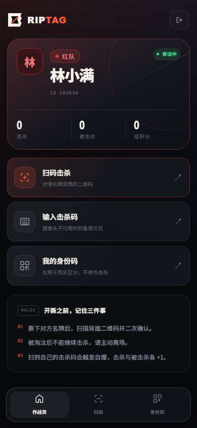
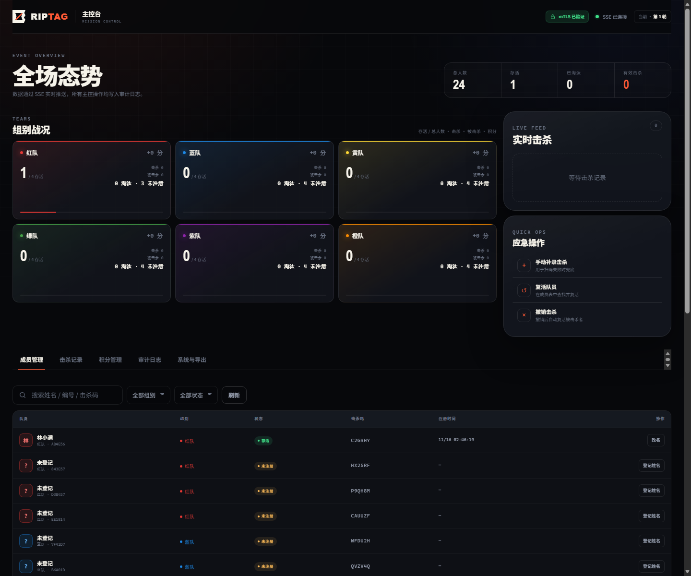
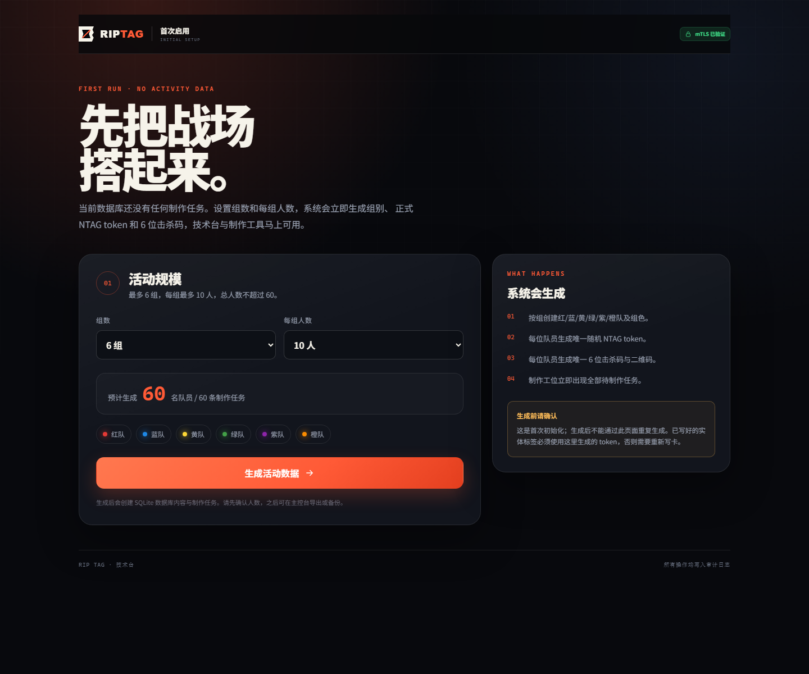
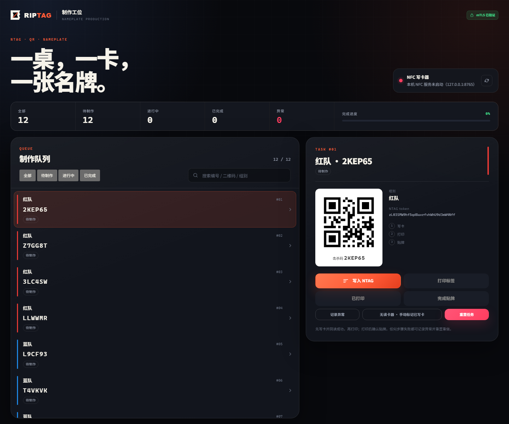

# RIP TAG · 撕名牌现场技术系统（v1.1）

为一场多人同时在线的「撕名牌」活动提供主项目 Web 系统。
队员碰 NTAG 入场，NPC 现场补注册与加分，主控在同一页完成实时看板、撤销、复活、
手动补录、积分修正、CSV 导出、重置和审计。

技术栈：**FastAPI + SQLAlchemy + SQLite WAL + 原生 HTML/CSS/JS + SSE + Nginx**。
页面不依赖 CDN，扫码库与二维码全部本地生成。









## v1.1 契约要点

- 种子字段统一为 `ntag_token, qr_code, group_no, group_color`。
- 种子导入到独立的 `production_tasks` 表；**队员注册时才创建 `members` 行**，通过
  `production_task_id` / `ntag_token` 关联。
- 制作状态只存在 `production_tasks`，不参与注册、击杀、看板、统计或重置。
- 主项目内置 **制作工位页面** `/production-<PRODUCTION_SECRET>/`，并保留 4 个
  `/api/production/*` 接口；NFC 写卡由可选的本地 `nfc-service` 提供，打印使用
  浏览器 A6 标签。
- 技术台 `console` 子域与制作工位 `production` 子域使用 mTLS；
  `play` / `npc` 子域使用普通HTTPS，不要求客户端证书。
- **首次启动向导**：没有活动数据时，主控台会询问组数和每组人数，自动创建
  `production_tasks`、组别、NTAG token 和二维码，不需要预先准备 CSV。
- 技术台可以直接创建 NPC；NPC 的击杀码在数据库中统一为 `XXXXXX`，不参与击杀。
- 制作工位可以从技术台创建的 NPC 列表把 `/staff/<token>` 写入 NPC NTAG。

## 角色与功能

### 队员

- 碰 NTAG 打开 `/r/<ntag_token>`；未注册填姓名，已注册恢复原队员 Cookie。
- `/home` 显示姓名、组别、状态、个人击杀/被击杀、组积分。
- 扫码击杀（`html5-qrcode` 本地库）、拍照识别，或手输 6 位击杀码。
  摄像头失败时自动提示权限/设备原因，并保留拍照和手动输入兜底。
- 击杀前二次确认，显示目标姓名、组别、存活状态。
- 扫/输自己的码 = 自爆：自己淘汰，击杀数 +1、被击杀数 +1。
- `/me/qr` 全屏展示身份二维码 `UID:<member_id>`，仅用于同名区分，不参与击杀。
- 已被淘汰时禁止继续击杀，页面显示淘汰状态。

### NPC 场务

- 碰预设 NPC NTAG 打开 `/staff/<npc_token>`，获得 NPC Cookie。
- 实时看板（SSE）、最近击杀、各组统计。
- 查看制作任务/已注册队员；为未注册队员补姓名；不能覆盖已有姓名。
- 给指定组加正分；不能撤销、扣分、复活、导出或手动补录击杀。
- 所有补注册和加分写入审计日志。

### 主控

- `/console-<CONSOLE_SECRET>/`，专有 URL + 客户端证书 mTLS。
- 实时看板、成员管理、改名、复活、撤销击杀、手动补录击杀。
- 新增积分修正（正/负）、撤销积分。
- NPC 管理：创建 NPC、复制/查看 `/staff/<token>` URL、停用 NPC。
- 击杀/积分/审计/本轮统计 CSV 导出，UTF-8 BOM，Excel 可直接打开。
- 软重置（新轮次、保留姓名/绑定、全员恢复存活）或硬重置（清空姓名、撤销队员会话）。
- 审计日志覆盖注册、改名、击杀、自爆、撤销、复活、积分、重置、导出和制作状态变更。
- 所有 mTLS 拒绝发生在 Nginx 和应用两层；后端只信任反代覆盖的 `X-Client-Verify`。

### 实时与一致性

- `/api/stream` SSE 推送看板；主控和 NPC 页面自动重连。
- 击杀写入使用 `UPDATE members SET status='eliminated' WHERE status='active'` 原子条件更新；
  并发扫同一目标只有一条成功。
- 撤销不物理删除记录，`kills.status=revoked`，统计自动回滚。
- 主控复活不撤销历史击杀；复活后再杀按新击杀处理。
- 手输码失败限速；所有击杀码查询也有总频率限制。

### 制作工位

- `/production-<PRODUCTION_SECRET>/`，专有 URL + 客户端证书 mTLS。
- 统计与队列：全部、待制作、进行中、已完成、异常。
- 单件任务：本地 NFC 写卡并回读 → 打印 A6 标签 → 完成贴牌。
- 无读卡器时可手动标记已写卡；失败可记录异常并重置重做。
- 二维码由服务端生成，打印窗口直接使用已认证的 SVG，不依赖 CDN。
- **NPC 标签**：从技术台创建的 NPC 列表写入 `/staff/<token>`，击杀码显示为
  `XXXXXX`（占位，不参与击杀）。
- 本地 NFC 服务运行在 `127.0.0.1:8765`，只监听本机；不启动也不影响手动流程。

## 制作工具 API

任务相关 4 个接口 + NPC 列表全部要求 mTLS（`X-Client-Verify: SUCCESS`，由 Nginx 覆盖写入）：

| 方法 | 路径 | 说明 |
|---|---|---|
| GET | `/api/production/tasks?status=all\|pending\|in_progress\|done` | 返回种子任务及制作状态数组 |
| POST | `/api/production/:id/mark` | body `{stage:"written"\|"printed"\|"done", error?}`；幂等 |
| POST | `/api/production/:id/reset` | 清除某条制作状态，允许重做 |
| GET | `/api/production/status` | 总数、已写、已打、已完成、失败数汇总 |
| GET | `/api/production/npcs` | 技术台创建的启用 NPC 列表（含 `/staff/` URL、占位码 `XXXXXX`） |

任务字段：

```json
{
  "id": 1,
  "ntag_token": "seed-token",
  "qr_code": "ABC123",
  "group_no": "红队",
  "group_color": "#E53935",
  "written_at": null,
  "printed_at": null,
  "done_at": null,
  "last_error": null,
  "stage": "pending",
  "stage_label": "待制作"
}
```

制作工位页面和 API 都在主项目中；NFC 写卡是可选的本机 Node 服务，打印使用浏览器。
制作状态不参与击杀统计、看板、业务规则；注册也不检查制作状态。

## 快速开始（本地开发）

需要 Python 3.11/3.12：

```bash
python -m venv .venv
# Windows: .venv\Scripts\activate
# Linux/macOS: source .venv/bin/activate
pip install -r requirements.txt
cp .env.example .env

python -m uvicorn app.main:app --host 127.0.0.1 --port 8000 --no-access-log
```

打开：

| 页面 | URL |
|---|---|
| 落地页 / 队员端 | <http://127.0.0.1:8000/> |
| 主控台（本地开发） | <http://127.0.0.1:8000/console-local-console-secret/> |
| 制作工位（本地开发） | <http://127.0.0.1:8000/production-local-production-secret/> |
| 主控台（真实 mTLS） | <https://localhost:8443/console-local-console-secret/> |
| 制作工位（真实 mTLS） | <https://localhost:8443/production-local-production-secret/> |
| NPC 登录 | 主控台「NPC 管理」创建，见下 |
| 队员入口 | 初始化后从制作工位读取任务 token，访问 `/r/<token>` |

**首次启动**：数据库没有制作任务时，打开主控台会进入“首次启用”向导，
填写组数和每组人数后自动生成数据库内容、组别、NTAG token 和 6 位二维码。
默认 `SEED_ON_STARTUP=false`，不会自动导入演示种子。

`.env.example` 默认开启本地 mTLS 绕过，因此 8000 可以直接打开主控；
当前工作区 `.env` 已关闭绕过并使用 `8443` Nginx mTLS。生产环境会拒绝
`ALLOW_INSECURE_CONSOLE` / `ALLOW_INSECURE_PRODUCTION` 两个开关。生产 Nginx/mTLS
配置见 [`deploy/README.md`](deploy/README.md)。

创建 NPC 令牌：

1. 主控台 →「NPC 管理」→ 输入名称 → 创建；
2. 复制生成的 `https://npc.<domain>/staff/<token>`；
3. 制作工位 →「NPC 标签」→ 选择 NPC → 写入 NPC NTAG。

也可以命令行创建：

```bash
python -m scripts.manage create-npc --name "NPC-A"
# 开发环境输出 http://127.0.0.1:8000/staff/<token>
```

NPC 的击杀码在数据库中固定为 `XXXXXX`，只是占位符，不参与击杀。

## 现场准备

### 1. 初始化活动（推荐）

首次启动且没有制作任务时，直接打开主控台，按向导填写组数和每组人数。
系统会生成数据库内容、组别和制作任务。**不需要准备 CSV**。

如果已经有一份正式 `seed.csv`，也可以设置 `SEED_ON_STARTUP=true` 或手动导入，
见下一节。

### 2. 生成正式种子（可选）

```bash
# 6 组 × 10 人 = 60 人；按需调整 --per-group（1-10）
python -m scripts.generate_seed \
  --per-group 10 \
  --out data/seed.csv \
  --urls-out output/ntag_urls.csv \
  --base-url https://play.example.com \
  --force
```

种子字段：

```csv
ntag_token,qr_code,group_no,group_color
<随机长 token>,<6 位码>,红队,#E53935
```

- `ntag_token`：16-128 位 URL 安全随机字符，数据库唯一。
- `qr_code`：6 位 `A-Z0-9`，数据库唯一。
- `group_no/group_color`：组名与组色；每组最多 10 人，组数最多 6。
- 导入器为兼容旧数据也接受 `group_name` 别名，但正式 CSV 必须用 `group_no`。

默认 `SEED_ON_STARTUP=false`，不会自动导入；需要 CSV 时设置
`SEED_ON_STARTUP=true` 启动一次，或运行 `python -m app.seed --csv data/seed.csv`。
已有任务后导入会被拒绝。

### 3. 写 NTAG

- 使用 NTAG215/216，写入 NDEF URL：`https://play.<domain>/r/<ntag_token>`。
- 使用 `output/ntag_urls.csv` 批量写卡；**写后回读验证 URL 完全一致**。
- 不要把 `ntag_token` 发到公开群；它就是队员登录凭证。

### 4. 打印击杀码标签

```bash
python -m scripts.print_cards --out output/name_tags.html
```

打开 HTML 直接打印 A4（10 张/页）。二维码内容就是 6 位击杀码，贴**名牌背面**；
身份二维码只存在手机页面里，不打印到实体名牌。

### 5. 部署

Ubuntu从发布包开始的完整步骤见
[`DEPLOYMENT.md`](DEPLOYMENT.md)，包含一键安装、Certbot、客户端 CA、mTLS、
systemd、备份和验收。更细的 Nginx/证书说明见
[`deploy/README.md`](deploy/README.md)。

发布包由以下命令生成：

```bash
python -m scripts.build_release
# dist/riptag-v1.1-ubuntu24.04.tar.gz
# dist/riptag-v1.1-ubuntu24.04.tar.gz.sha256
```

```bash
sudo PLAY_DOMAIN=play.example.com \
     NPC_DOMAIN=npc.example.com \
     CONSOLE_DOMAIN=console.example.com \
     PRODUCTION_DOMAIN=production.example.com \
     bash deploy/install_ubuntu.sh
```

## 页面与 API

| 路径 | 角色 | 说明 |
|---|---|---|
| `/r/:ntag_token` | 队员 | NTAG 入口；未注册填姓名，已注册恢复登录 |
| `/home` | 队员 | 姓名、组别、状态、扫码/手输/身份码入口 |
| `/me/qr` | 队员 | 全屏身份二维码 `UID:<member_id>` |
| `/scan` | 队员 | 摄像头扫码 |
| `/kill/manual` | 队员 | 手动输入 6 位码 |
| `/kill/confirm?code=...` | 队员 | 二次确认目标 |
| `/staff/:npc_token` | NPC | NPC 登录并下发 Cookie |
| `/staff` | NPC | 实时看板、补注册、组加分 |
| `/console-<secret>/` | 主控 | mTLS 主控台（看板与操作同页） |

核心 JSON API：

```text
POST /api/register
GET  /api/me
GET  /api/me/qr
POST /api/kills/lookup
POST /api/kills/confirm
POST /api/npc/register          {task_id, name}
POST /api/npc/score
GET  /api/dashboard
GET  /api/stream                SSE

GET  /api/production/tasks      mTLS
POST /api/production/:id/mark   mTLS
POST /api/production/:id/reset  mTLS
GET  /api/production/status     mTLS

POST /console-<secret>/api/kills/manual
POST /console-<secret>/api/kills/:id/revoke
POST /console-<secret>/api/members/:id/revive
POST /console-<secret>/api/members/:id/name
POST /console-<secret>/api/score
POST /console-<secret>/api/score/:id/revoke
GET  /console-<secret>/api/export?type=kills|scores|audit|summary
POST /console-<secret>/api/reset
GET  /console-<secret>/api/stream
```

接口错误统一为：

```json
{"ok": false, "error": {"code": "victim_eliminated", "message": "该队员已被击杀"}}
```

## 关键业务口径

| 场景 | 实现 |
|---|---|
| 注册 | 用 `ntag_token` 查 `production_tasks`；创建/补全 `members`，写 `production_task_id` |
| 制作状态 | 仅在 `production_tasks`；不参与注册、击杀、看板、规则 |
| 同组击杀 | 允许；不额外校验组别 |
| 已淘汰者被二次扫 | 不写记录，返回 409 `victim_eliminated` |
| 自爆 | `killer=victim`, `kind=self`；一条记录同时计入击杀与被击杀 |
| 并发同扫 | 数据库原子条件更新；输家 409，不产生重复记录 |
| 撤销击杀 | `status=revoked`；统计回滚；被击杀者自动复活；保留历史 |
| 撤销旧击杀 | 若该队员之后又被杀，撤销旧记录不会错误复活当前淘汰状态 |
| 主控复活 | 只改 `status=active`，不回滚历史击杀；之后可再次被击杀 |
| 手动补录 | `source=manual`，note 标记“技术台手动添加”，同样执行淘汰校验 |
| 身份码 | `UID:<member_id>`，只做同名区分；自爆只认 6 位击杀码 |
| 重置 | 默认软重置；硬重置清空姓名并撤销队员会话；任务/历史保留 |
| 统计 | 只统计当前 active round；总人数来自 `production_tasks` |

## 数据模型

```text
groups(id, name, color, created_at)
rounds(id, name, status, started_at, ended_at)

production_tasks(
  id, ntag_token unique, qr_code unique, group_no, group_color,
  written_at, printed_at, done_at, last_error, created_at
)

members(
  id/member_id, production_task_id unique, ntag_token unique, qr_code unique,
  group_id, group_no, group_color, name, status,
  registered_at, created_at
)

sessions(id, token_hash, member_id, staff_token_id, role,
         created_at, expires_at, revoked)
staff_tokens(id, token, role, name, qr_code='XXXXXX', active, created_at)
kills(id, round_id, killer_id, victim_id, kind, source, status,
      created_at, revoked_at, revoked_by, note)
score_adjustments(id, round_id, group_id, delta, reason,
                  operator_role, operator_id, status, created_at, ...)
audit_logs(id, round_id, actor_role, actor_id, action,
           target_type, target_id, payload_json, created_at)
```

SQLite 开启 WAL、外键、15 秒 busy timeout；取消/重置均不物理删除历史。
v1.0 数据库启动时自动迁移：旧 `members` 中的种子/制作字段复制到
`production_tasks`，并给成员补齐 `production_task_id/group_no/group_color`。

## 安全与证书隔离

- 子域隔离：
  - `play.<domain>`：队员页面，`ssl_verify_client off`；
  - `npc.<domain>`：NPC 场务，`ssl_verify_client off`；
  - `console.<domain>`：主控，`ssl_verify_client on`；
  - `production.<domain>`：制作工位页面 + API，`ssl_verify_client on`。
- 技术台与制作工具共用客户端 CA；NPC/队员使用 Let's Encrypt 服务器证书，不提示证书。
- 主控：Nginx 覆盖写入 `X-Client-Verify`；后端只接受 `SUCCESS`；Uvicorn 仅监听 `127.0.0.1`。
- 队员 Cookie：256-bit 随机 token，服务端只存 SHA-256；`HttpOnly; Secure; SameSite=Lax`。
- 队员/NPC token 在 URL 中，Nginx 与 Uvicorn 访问日志均关闭。
- 静态二维码可被拍照复制，这是需求接受的规则风险；不做动态防伪。
- 导出 CSV 做公式注入防护；备份和导出包含姓名/码，按敏感数据保管。
- 6 位码限速为进程内状态，因此生产只运行一个 worker。

## 目录

```text
app/
  main.py, config.py, models.py, db.py, security.py
  routes/        member.py staff.py realtime.py console.py production.py
  services/      members.py kills.py scores.py stats.py activity.py
                 production.py audit.py
  templates/     landing register home me_qr scan manual confirm staff console ...
  static/        css app.css / js vanilla modules / vendor html5-qrcode
scripts/
  generate_seed.py  print_cards.py  manage.py  backup.py
data/seed.csv       演示种子（正式活动请替换）
DEPLOYMENT.md        Ubuntu 24.04 从零部署指南
deploy/
  install_ubuntu.sh   Ubuntu 24.04 一键安装脚本
  README.md          运维与 Nginx/证书详解
  nginx.conf.example 子域隔离示例
  riptag.service
  certs/             客户端 CA / .p12 证书脚本与说明
tests/               业务规则、制作 API、Schema 迁移测试
nfc-service/         可选本地 NFC 写卡服务（仅监听 127.0.0.1）
```

## 已知边界

- 单机单 worker，面向一场最多约 70 台手机；不适用于多场并发或跨服务器水平扩展。
- SQLite 足够本场景；代码未适配 PostgreSQL（需求中的“可选”未实现）。
- 二维码为静态码，防伪依赖活动规则，不防拍照复制。
- NFC 依赖手机系统后台读取 NDEF URL；iPhone XS / iOS 13+ 体验最佳，现场用 NPC 补注册兜底。
- 制作工位页面已集成；NFC 写卡是可选的本地 Node 服务，未启动时可用手动标记流程。
- 重置/撤销/复活都保留历史，不会产生物理删除


